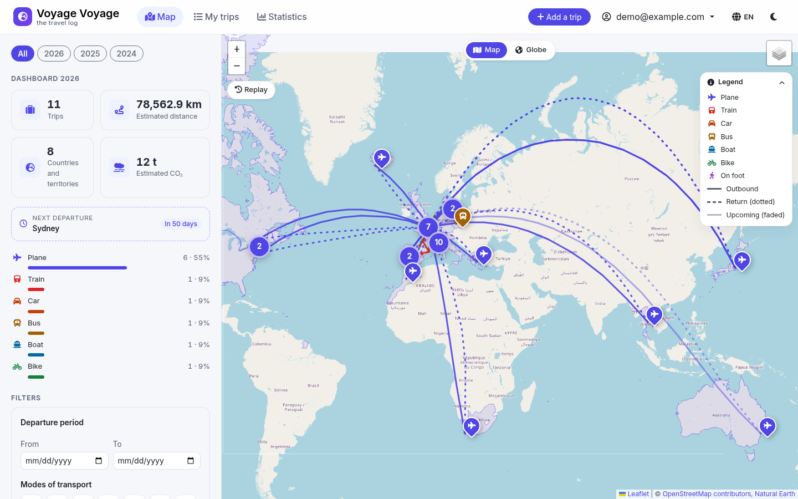
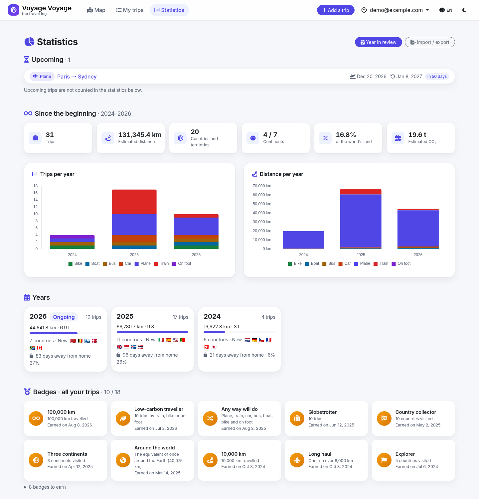
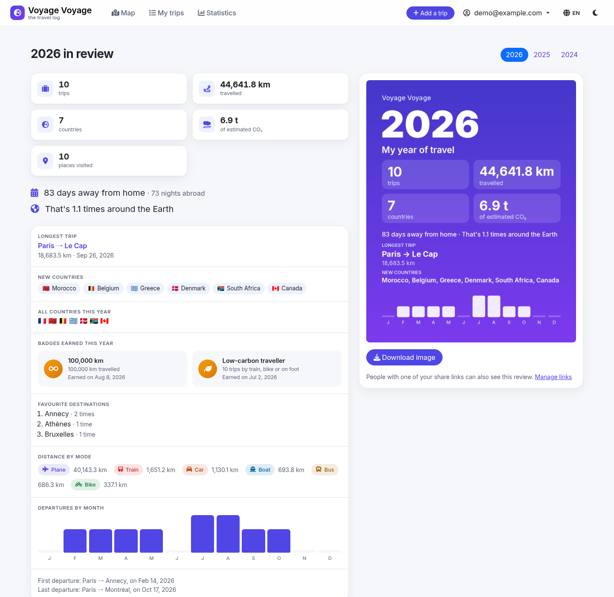
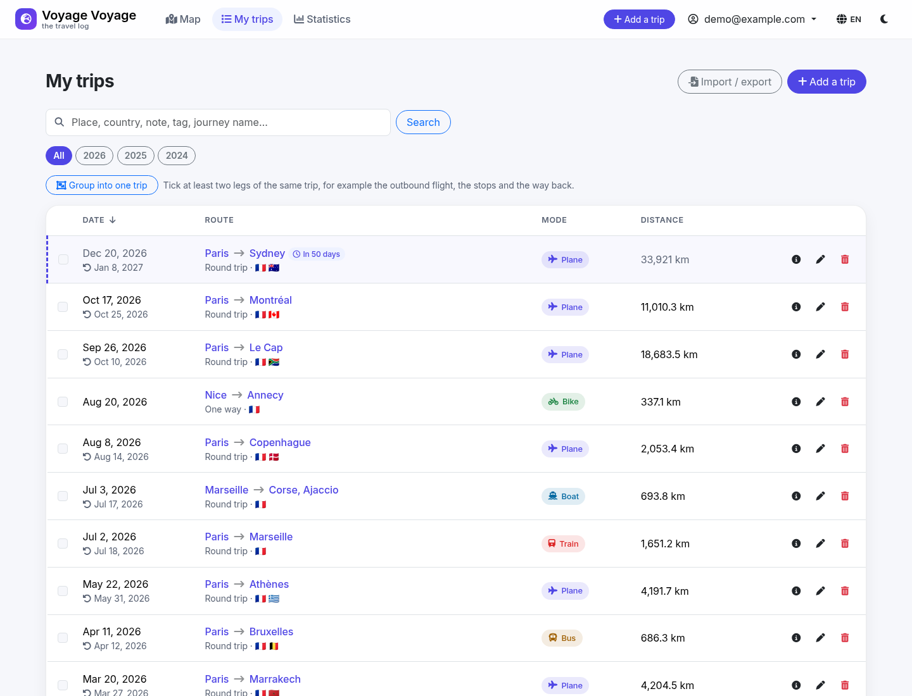
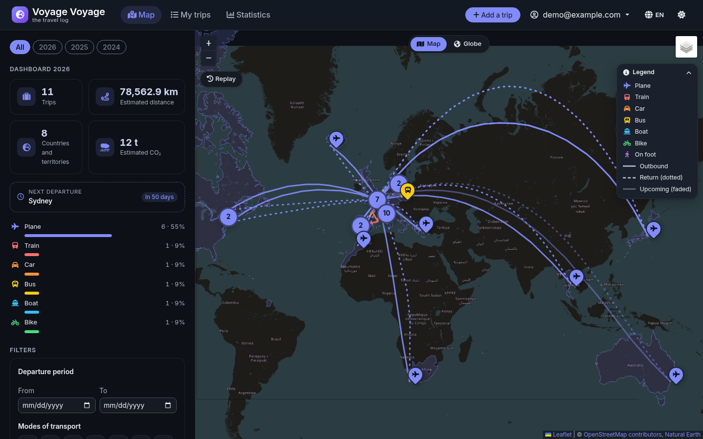
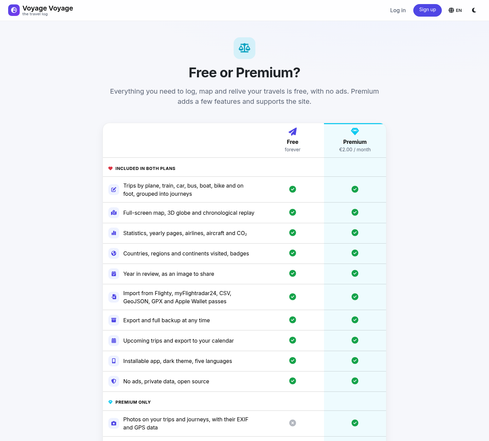
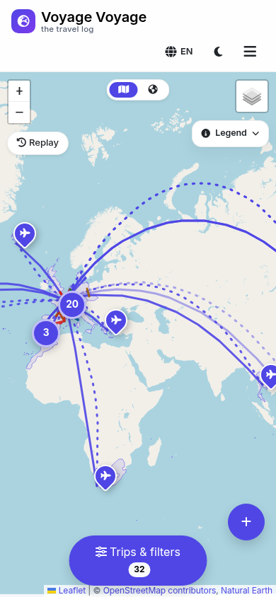

# Voyage Voyage

*Version française : [README_FR.md](README_FR.md)*

**Your personal travel log, on a map.** Log every trip by plane, train, car, bus, boat, bike or on foot,
see them on a world map or a 3D globe, and turn your years of travel into statistics, badges and a year
in review. In French, English, Spanish, German and Italian.

🌍 **Live:** <https://voyage-voyage.app>



| | |
|---|---|
|  |  |
| **Statistics** | **Year in review** |
|  |  |
| **My trips** | **Dark theme** |
|  |  |
| **Free or Premium** | **On a phone** |

## Features

- **Map and globe**: trips coloured by mode, geodesic arcs for flights, dashed returns, clustered markers,
  "Countries visited" and "Places visited" layers, a 3D globe and a chronological replay.
- **Statistics**: key figures and charts per year and mode, a page per year with a day-by-day calendar,
  plane and train pages (airlines, aircraft, airports, stations), estimated CO₂, days away from home.
- **The world, country by country**: countries and territories visited out of 237, continents, regions of
  14 large countries, and badges for all your trips and for each year.
- **Year in review**: your year in figures, and an image to share.
- **Import and export**: Flighty and myFlightradar24 histories, CSV, GeoJSON and GPX without loss,
  Apple Wallet boarding passes, flight number lookup, full backup with photos.
- **Notes, photos and tags** on every trip and journey; upcoming trips and calendar export (`.ics`).
- **Sharing**: read-only links with expiry and an optional public profile.
- **Everywhere**: installable app that works offline, light and dark themes.
- **Private by design**: no ads, every library bundled (no CDN), self-hosted analytics you can refuse,
  export and account deletion at any time.
- **Premium** (Stripe, 2 € a month or 12 € a year by default): photos, import by email, share links,
  public profile and support. Without a Stripe key, everything is free.

Every feature in detail: [FEATURES.md](FEATURES.md).

## Quick start

```bash
git clone https://github.com/JMousqueton/travellog.git && cd travellog
make install && cp .env.example .env     # then fill in SECRET_KEY, NOMINATIM_USER_AGENT and DATABASE_URL
.venv/bin/flask db upgrade
.venv/bin/flask seed                      # optional: demo@example.com / demo1234
.venv/bin/flask run --debug               # http://127.0.0.1:5000
```

Requirements, production, periodic tasks, backups, Stripe, configuration, API, tests and translations:
[INSTALL.md](INSTALL.md).

## Built with

Python and Flask, PostgreSQL, Leaflet, d3-geo, Chart.js, Bootstrap, Font Awesome and the Inter font,
all served by the application itself.

## License

[MIT](LICENSE). Data sources and their licences (Natural Earth, OurAirports, OpenFlights) are listed in
[INSTALL.md](INSTALL.md).

Voyage Voyage was coded with the help of AI.
